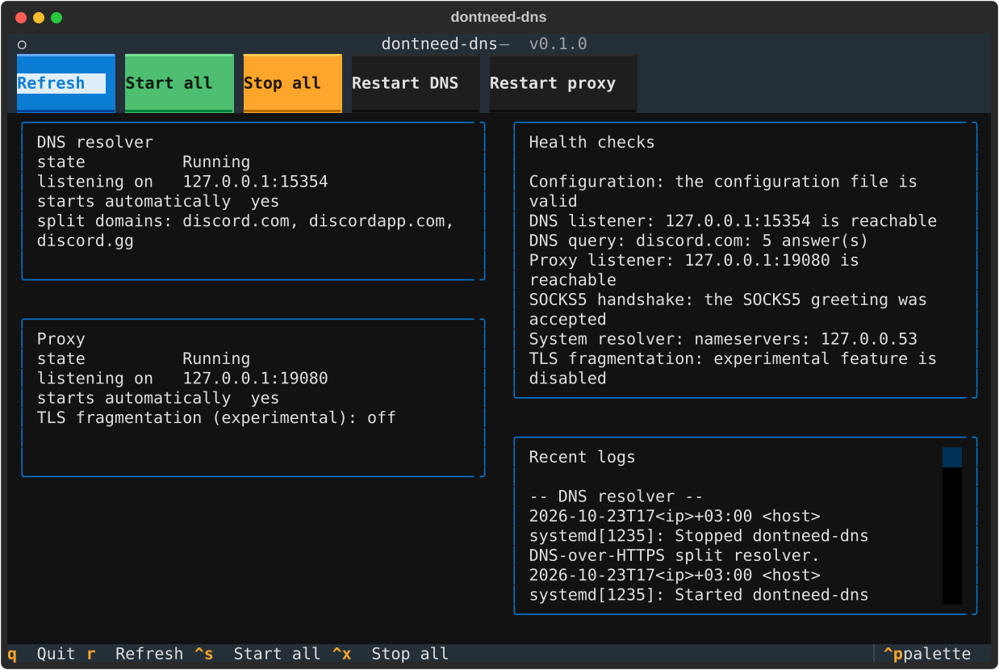

# dontneed-dns

Cross-platform DNS-over-HTTPS and proxy management for Discord connectivity.

`dontneed-dns` is a small, auditable tool for the situation where Discord
is reachable over a normal connection but its DNS queries or its TLS
handshake are blocked.  It runs two local components:

* a **DNS-over-HTTPS split resolver** on `127.0.0.1:5354` that answers the
  configured domains over HTTPS and forwards everything else to the system
  resolver,
* a **SOCKS5 / HTTP CONNECT proxy** on `127.0.0.1:10808` that resolves the
  requested host itself over DNS-over-HTTPS and can split the TLS
  ClientHello into small pieces.

Linux and Windows are two separate, first class editions with their own
installation, service management, permission model and release package.
Nothing is shared between them except the protocol code.

---

## Supported platforms

| Platform | Status | Background process | Log |
| --- | --- | --- | --- |
| CachyOS / Arch Linux | Verified | `systemd --user` unit | `journalctl` |
| Ubuntu / Debian | Verified | `systemd --user` unit | `journalctl` |
| Fedora | Verified | `systemd --user` unit | `journalctl` |
| Windows 11 x64 | Verified | Scheduled task | Log file |
| Windows 10 x64 | Expected | Scheduled task | Log file |

macOS and every other operating system are not supported.  The tool refuses
to run there instead of pretending to work.

## Releases

Every release contains two archives and, for Windows, the self contained
executable:

| Asset | Size | Runtime requirement |
| --- | --- | --- |
| `dontneed-dns-linux-x86_64.zip` | ~2.7 MB | Python 3.11 or newer (the installer creates a virtual environment) |
| `dontneed-dns-windows-x86_64.zip` | ~18 MB | none (the archive contains the executable) |
| `dontneed-dns.exe` | ~16 MB | none |
| `SHA256SUMS` | - | the checksum of every file |

```bash
gh release download v0.1.2 --dir dontneed-dns
cd dontneed-dns && sha256sum -c SHA256SUMS
```

The Windows executable is **not digitally signed**.  Windows shows a
warning the first time it is started; compare the checksum before doing
anything about it.

## Feature comparison

| Feature | Linux | Windows |
| --- | --- | --- |
| DNS-over-HTTPS resolver on `127.0.0.1:5354` | Supported | Supported |
| Split routing (Discord domains over DoH) | Supported | Supported |
| System resolver fallback | Supported (all record types) | Supported (A and AAAA only) |
| DNS over TCP | Supported | Supported |
| SOCKS5 proxy | Supported | Supported |
| HTTP CONNECT proxy | Supported | Supported |
| TLS ClientHello fragmentation | Experimental | Experimental |
| Per application DNS interception | Supported with limitations | **Unsupported** (needs a driver) |
| System wide DNS / firewall / routing changes | Never done silently | Never done silently |
| Service in the user scope | `systemd --user` | Scheduled task |
| Service in the system scope | `systemd` system unit (root) | Windows service (administrator, `pywin32`) |
| Automatic startup | `systemctl enable` | Scheduled task |
| Logs | `journalctl` | Log file |
| Terminal interface | Supported | Supported |
| Self contained executable | Not shipped | Shipped (PyInstaller) |
| Portable archive with an offline installer | Shipped | Shipped |

The complete matrix with the notes of every entry lives in
`docs/architecture.md` and in `dontneed_dns/core/capability.py`; the command
`dontneed-dns status` prints the entries that matter on the running machine.

## Installation on Linux

```bash
unzip dontneed-dns-linux-x86_64.zip
cd dontneed-dns-linux-x86_64
./install.sh
export PATH="$HOME/.local/share/dontneed-dns/venv/bin:$PATH"
```

The installer creates a virtual environment from the bundled wheelhouse (no
network access needed), registers the systemd user services and never needs
root.  See [docs/linux.md](docs/linux.md) for the details, for the system
scope and for the rollback.

## Installation on Windows

```powershell
Expand-Archive dontneed-dns-windows-x86_64.zip
cd dontneed-dns-windows-x86_64
powershell -ExecutionPolicy Bypass -File install.ps1
```

The archive contains a self contained executable; Python, Git and a compiler
are not needed.  See [docs/windows.md](docs/windows.md) for the details and
for the optional Windows service.

## Using it

```bash
dontneed-dns status              # the state of both components
dontneed-dns dns start            # start the resolver
dontneed-dns proxy start          # start the proxy
dontneed-dns check                # the health checks
dontneed-dns logs -n 100          # the recent log lines
dontneed-dns config validate      # check the configuration
dontneed-dns tui                  # the terminal interface
dontneed-dns doctor -o report.json  # a redacted diagnostic report
```

Every command works without an interactive terminal, so the tool can be used
from a script.

### The terminal interface



The image was rendered from the real interface with
`python scripts/make_screenshot.py docs/tui.svg`; it is not a drawing.

### Pointing an application at the proxy

```bash
dontneed-dns launch discord
```

Only the launched process is affected: the proxy variables are exported into
its environment and nowhere else.  Chromium based applications also accept
the proxy directly:

```bash
discord --proxy-server="socks5://127.0.0.1:10808"
```

## Configuration

The configuration is a TOML file:

| Platform | Location |
| --- | --- |
| Linux | `~/.config/dontneed-dns/config.toml` |
| Windows | `%APPDATA%\dontneed-dns\config.toml` |

```bash
dontneed-dns config path      # where the file is
dontneed-dns config init      # write it with the default values
dontneed-dns config show      # print the effective configuration
dontneed-dns config validate  # check it
```

```toml
[dns]
listen_host = "127.0.0.1"
listen_port = 5354
split_domains = ["discord.com", "discordapp.com", "discord.gg", "dis.gd"]
doh_providers = ["cloudflare", "google", "quad9"]
timeout = 3.0
retries = 1
system_fallback = true

[proxy]
listen_host = "127.0.0.1"
listen_port = 10808
enable_socks5 = true
enable_http_connect = true
resolve_via_doh = true
fragmentation_enabled = false
fragment_chunk_size = 16
connect_timeout = 5.0
idle_timeout = 300.0

[service]
scope = "user"
autostart = false

[logging]
level = "info"
redact = true
```

The configuration is validated strictly: an unknown option is an error, so a
typo can never silently disable a feature.

## Security and privacy

* No telemetry, no analytics, no crash reporter, no phone home.
* No credentials are read or stored.
* TLS certificate verification is always on and cannot be switched off.
* The log contains the queried domain, never the address of the client.
* `dontneed-dns doctor` produces a report in which the home directory, the
  user name, the host name, mail addresses, tokens and globally routable
  addresses are removed.
* No kernel driver, no unsigned binary, no rootkit.
* The system wide DNS settings, the firewall, the routing table and the
  Windows network settings are never changed silently.

More in [docs/security.md](docs/security.md).

## Known limitations

* **No guarantee of any kind.**  The tool cannot promise that Discord is
  reachable from every network, that a particular middlebox is bypassed,
  that the traffic is anonymous or that every internet provider behaves the
  like.  What it does is described precisely above; what it does not do is
  described here.
* **TLS fragmentation is experimental.**  It changes only the packet
  boundaries, never the encrypted payload.  Whether a specific middlebox is
  confused by it cannot be verified from inside this project.  It is
  disabled by default.
* **Per application DNS interception is not possible on Windows** without a
  kernel driver.  The proxy resolves the host itself, so the plain text DNS
  lookup is avoided anyway.
* **The Windows system fallback only synthesises A and AAAA records.**  The
  Windows resolver cannot be queried with a raw DNS message from Python.
* **A scheduled task starts at the next login.**  A user level background
  process that survives a reboot without a service needs a session.
* **The Windows executable is not digitally signed.**
* **A scheduled task of the Windows edition needs the Task Scheduler.**  If
  the terminal is not allowed to create one, the installation fails with the
  exact error of `schtasks` and has to be repeated from an elevated
  PowerShell window.  The configuration is kept.

## Troubleshooting

See [docs/troubleshooting.md](docs/troubleshooting.md).  The short version:

```bash
dontneed-dns check      # what is broken
dontneed-dns logs -n 100
dontneed-dns doctor -o report.json
```

## Uninstall and rollback

Linux:

```bash
dontneed-dns uninstall --scope user --yes    # add --purge for the configuration
./uninstall.sh --purge                       # from the release archive
```

Windows:

```powershell
dontneed-dns uninstall --scope user --yes
powershell -ExecutionPolicy Bypass -File uninstall.ps1 -Purge
```

The uninstall removes only what this project created: the systemd units or
the scheduled tasks, the executable, the virtual environment and - only when
asked for - the configuration file.

## Contributing

Issues and pull requests are welcome.  Please read
[CONTRIBUTING.md](CONTRIBUTING.md) first; it describes how to run the tests
on both platforms and what a change has to include.

## Licence

MIT, see [LICENSE](LICENSE).  The licences of the bundled dependencies are
listed in [docs/security.md](docs/security.md).
